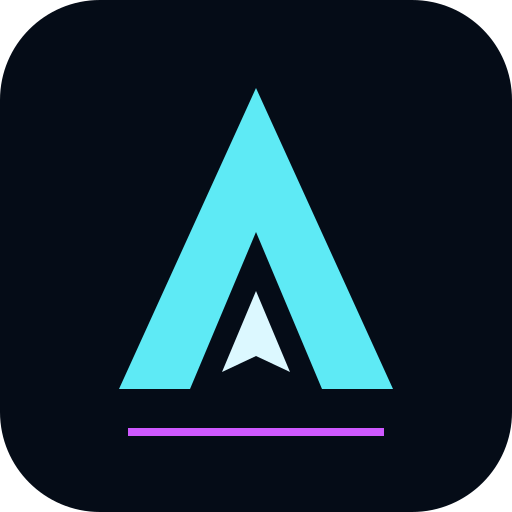
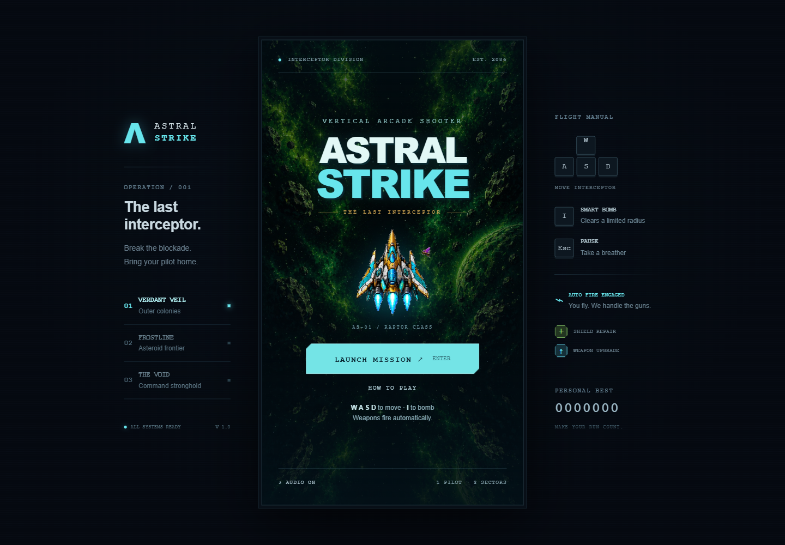
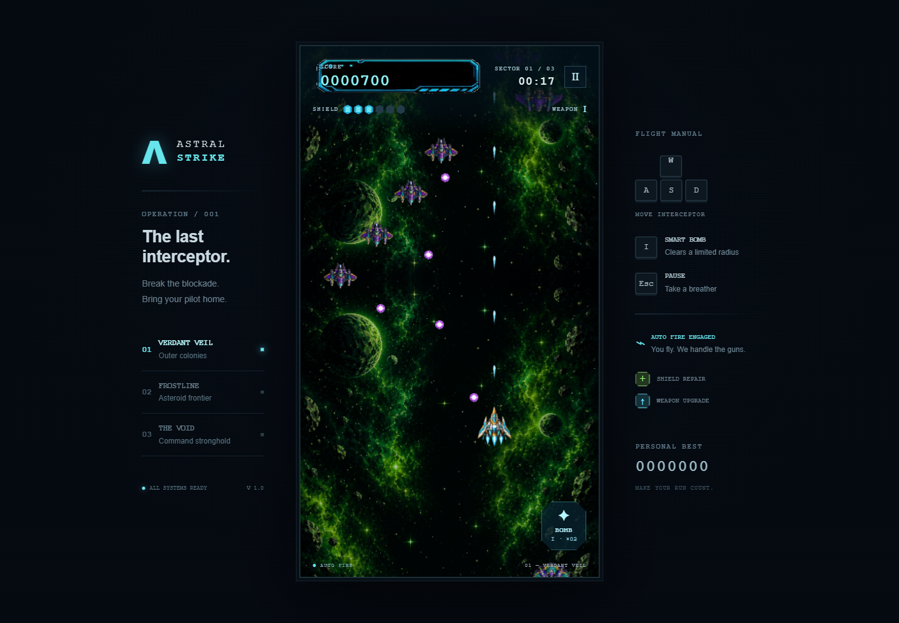
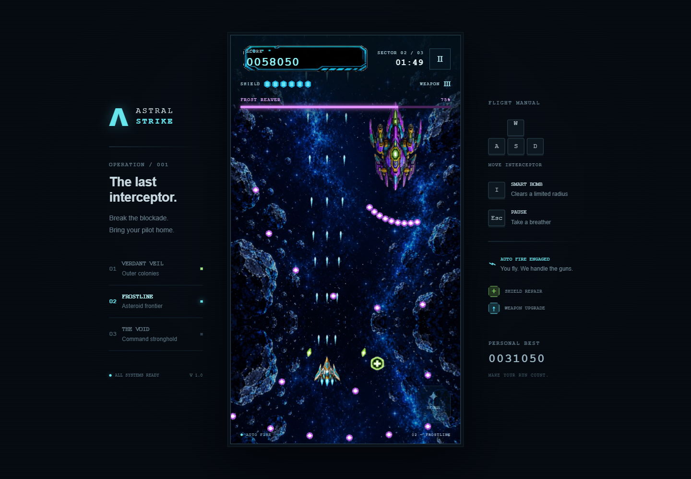

<p align="center">
  
</p>

<h1 align="center">Astral Strike</h1>

<p align="center">
  <strong>The last interceptor. Three sectors. One mission.</strong><br />
  An AI-assisted arcade shooter to explore, run, and learn from.
</p>

<p align="center">
  <a href="https://creativecommons.org/publicdomain/zero/1.0/">
    
  </a>
</p>



> **Reference work for people starting AI projects.** This is an educational prototype showing what an AI-assisted workflow can produce. Use it to learn, experiment, and ask questions; it is not presented as a production template or a guide to best practices.

A three-sector vertical arcade shooter with **Three.js rendering**, **plain JavaScript simulation**, **Vite packaging**, and **offline PWA support**. Fly with a keyboard or touch controls, collect upgrades, and break through three boss encounters.

## Gameplay

| Verdant Veil · enemy waves | Frostline · boss encounter |
| :---: | :---: |
|  |  |

Screenshots captured from the running game. Open an image to see the full-size view.

## Why this exists

This educational project was created to test GPT 6 Astra and to show Product AI students how quickly a working prototype can be built with OpenAI Codex. It was produced in a single, one-shot 40-minute work session and is shared as a reference for people taking their first steps with AI projects.

Start by running the game, then explore how input, game rules, rendering, and audio fit together. The [project experiences](experiences.md) document bugs, fixes, and validation findings from the build.

## Run

Node.js 22.12+ is recommended.

```sh
npm install
npm run dev
```

Open the local URL printed by Vite. For a production/offline test:

```sh
npm run build
npm run preview
```

For phone testing on the same network, use Vite’s network URL. Installing a PWA and offline caching require HTTPS, or localhost on the testing device; a plain HTTP LAN address supports gameplay but not installation. Deploy the contents of `dist/` to any static HTTPS host.

## Controls and campaign

- WASD moves; weapons fire automatically. I fires a bomb. Escape pauses/resumes.
- Touch: drag in the lower-left flight area to position and move the floating joystick. The right button fires a bomb. Pause is at the top right. Simultaneous joystick and bomb input is supported.
- Six shields, a small bullet hitbox, brief damage invulnerability, and three bombs per sector.
- Bombs destroy all enemies whose centres are inside the 188-unit radius at activation, including bosses. Nearby enemy bullets are cleared too.
- Green + restores two shields; arrow pickups increase firepower up to level three.
- Each sector has 100 seconds of enemy waves followed by a boss. Defeat all three bosses to finish. Cleared sectors restore two shields and replenish bombs.
- Failure offers a retry from the beginning of the current sector, restoring its starting score and weapon level. Personal best and audio preference are optional local browser storage.
- Audio is synthesized locally. No runtime external font, image, sound, or library requests.

## Structure

- `src/game.js`: renderer-independent fixed-step rules and campaign state.
- `src/renderer.js`: orthographic Three.js scene; instanced sprite batches.
- `src/assets.js`: source-sheet texture extraction in memory.
- `src/main.js`: UI, input, lifecycle, and frame loop.
- `src/audio.js`: synthesized sound and music.
- `vite.config.js`: build-specific offline cache generation.
- `reference/`: original artwork sheets; runtime copies are in `public/assets/`.
- `docs/images/`: title-screen and gameplay images used in this README.

The development build exposes `window.__arcade` for inspecting live state in desktop debugging. Vite removes that branch from the production build. It does not change damage, timing, or progression.

See `experiences.md` for implementation findings and `output/playwright/` for local QA artifacts (excluded from source control).

## Validation

`node scripts/verify-game.mjs` checks combat and progression boundaries. Playwright completed all three stages through the victory screen with normal keyboard input (6:17, 330 kills), and verified desktop controls, real game-over/retry, two-finger touch controls, small-screen layout, and a disconnected production reload with playable combat. Mobile validation used Chromium emulation; physical-phone installation was not tested.

## License and artwork

The project's original contributions, including its code, documentation, and original logo, are dedicated to the public domain under [CC0 1.0 Universal](https://creativecommons.org/publicdomain/zero/1.0/). You may copy, modify, and share those contributions, including commercially, without attribution.

**Third-party material is excluded from this dedication.** The game artwork in `reference/` and `public/assets/`, including that artwork as shown in the screenshots above, is not covered by CC0. It was obtained as publicly available, free-to-use artwork, but its original author and license were not recorded. Verify its permissions or replace it before reusing the artwork in another project. Dependencies retain their own licenses.
